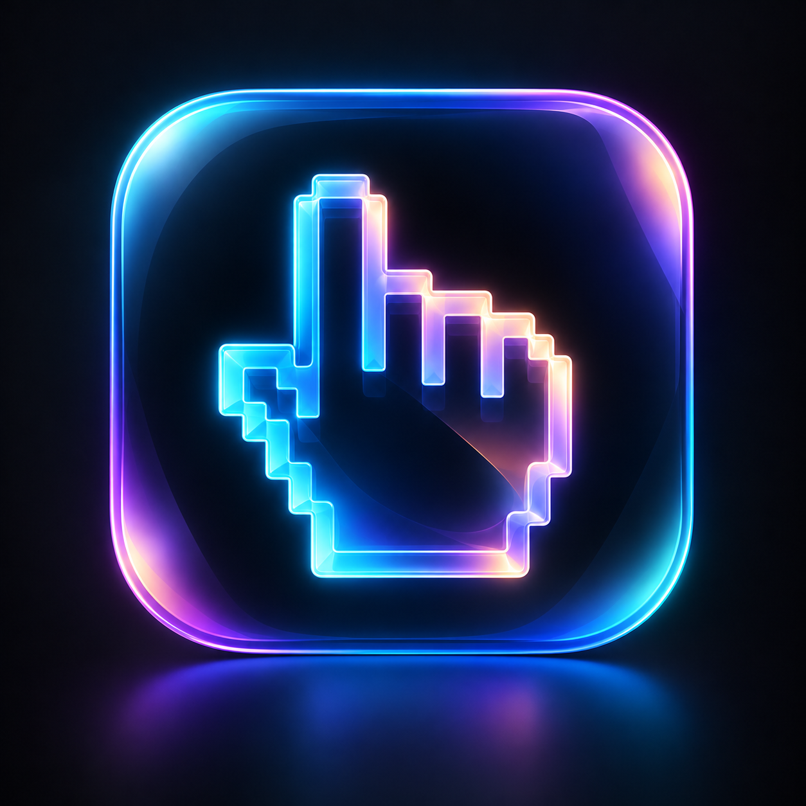

# STARK



**Your hands are the interface.** A native macOS hand-control app with a camera preview, floating mini preview, multi-display pointer control, configurable gestures, guided practice and optional double-clap wake.

Formerly Dex. This repository keeps its original **DEX** URL.

## Install on your Mac

1. Choose **Code → Download ZIP** above, unzip it, and move the folder somewhere permanent, such as Documents/STARK.
2. Install **Python 3.12** from [python.org](https://www.python.org/downloads/macos/) if needed. Python 3.9–3.13 is accepted by the installer. Install Apple Command Line Tools by running `xcode-select --install` in Terminal if they are not already installed.
3. Double-click **Install STARK.command**. If Finder cannot run it, open Terminal, type `bash ` (with a space), drag **Install STARK.command** into Terminal, and press Return.
4. Open **STARK.app** on your Desktop and follow the walkthrough. Grant Camera and Accessibility when asked. Drag the app into your Dock to keep it there.

Setup downloads Python dependencies. The hand-tracking model downloads from Google's MediaPipe storage on first use (about 8 MB). An internet connection is needed for those downloads. Double-clap wake additionally asks for Microphone permission when you enable it.

**STARK.app is the launcher; this source folder is its engine. Keep both.** The folder does not have to stay on your Desktop. Build the app on each recipient's Mac: an already-built app contains paths specific to that machine. This source distribution is not a self-contained, notarized Mac installer. The native launcher targets macOS 12 or later; dependency support may vary by OS and architecture.

Quit STARK before reinstalling. If you move the source folder, recreate its `.venv` and rerun the installer. Your mappings and tuning live in `config.json`; back it up before replacing the source folder with a newer download.

## New in 1.1

- **All displays:** pointer movement spans your connected displays, including displays to the left or above the main one. Layout is refreshed during use. Positions in gaps between screens snap to the nearest visible edge. For precise targets, hold a fist with your shortcut hand to slow the pointer.
- **Mini preview:** click **Mini preview** in the main window or menu bar for a small floating camera panel in the bottom-right corner. Drag its title bar to reposition it. **Stop** pauses control; **Expand** brings the full window back. Closing either preview turns gestures off. Some exclusive full-screen apps may cover floating panels.
- **Camera:** Settings defaults to **Automatic · laptop / webcam only**. Phones are only selected explicitly. Camera choices are stored by stable device ID, not a number that can change when devices reconnect. If the selected device disappears, STARK stops instead of choosing another camera. The OpenCV capture order now matches its device-ID ordering.
- **Gesture guard:** enabled by default. Show each hand as an open palm for roughly half a second to arm it. Tracking jumps and lost hands need another open palm. Hands passing in front of your face no longer pause control: image overlap cannot reliably distinguish distance or contact. Pinches must remain closed for 80 ms before a click. The live status explains when control is waiting. Both fists still stops STARK. You can disable the guard in Settings. Gesture recognition can miss things; switch gestures off when taking a break.
- **Double-clap wake:** enable this in Settings and allow Microphone access. While gestures are off, clap twice roughly half a second apart. STARK turns gestures on through its normal Camera/Accessibility permission checks. The menu bar shows **STARK ◉** and the window says **Listening for two claps · microphone on**. Listening pauses during control, onboarding and settings. Audio stays in memory and is never recorded or uploaded. It uses the input selected in macOS Sound settings. This detects sound impulses, not speech; similar noises can trigger it. STARK must remain running in the menu bar—claps cannot launch a fully quit app or wake a sleeping Mac.

## Open STARK

Click **STARK** in the Dock or double-click **STARK.app** on your Desktop. STARK opens with gestures and the camera **off**.

The first time, a one-minute walkthrough shows you how to find your hand, move, pinch to click, scroll and stop. It's practice only and never moves your real pointer. **Show me how** runs it again.

## On and off

- **In the window:** **Turn gestures on** / **Turn gestures off**.
- **In the menu bar:** **STARK ○ / STARK ●**.
- **From any app:** **⌃⌥M** (Control–Option–M).
- **With your hands:** hold both fists for a second to switch off.

Off means the camera is released and no hand gestures are recognized. Optional double-clap wake can still listen to the microphone. Closing the window also switches gestures off. **⌘Q** quits STARK.

## Permissions

STARK asks for **Camera** the first time it needs to see your hands, and for **Accessibility** the first time you let it control your Mac (macOS requires this before any app can move the pointer or press keys).

When STARK needs Accessibility, it opens the right page in System Settings and waits. Turn on **STARK** in the list and STARK starts by itself. You don't need to press anything again.

If STARK already shows **On** but still waits, that switch belongs to an older copy of the app. Click **Fix permission…** in STARK: it clears the old entry and asks again, and you turn STARK on once more. STARK is signed so this doesn't happen again when it's rebuilt.

Video is processed on this Mac. It's never recorded or uploaded. The same applies to optional clap audio.

## Controls

**Controls…** (in the window, the menu bar, or ⌘K) lists every gesture like a game's controls screen: the gesture, which hand, what it does, and the exact key or click STARK sends.

- Pick a new action from the menu next to any gesture, including gestures that start out unassigned.
- Click an input (like **⌘C**) and press a new shortcut to record it. Esc cancels.
- The dictation row records a modifier key on its own too, like **fn** for Wispr Flow.
- Built-in moves (pointer, click, scroll, zoom, stop) show a lock.
- **Restore Defaults** resets everything. **Save** applies it right away. **Cancel** changes nothing.

Gestures stay off while Controls or Settings is open.

## Settings

Pointer hand, camera, pointer feel, scroll speed, reversed scrolling and the dictation gesture. **Fine-tune…** has pinch sensitivity and hold timing.

## Repair or reinstall

Quit STARK and run **Install STARK.command** again. It installs dependencies, runs the tests, and rebuilds the Desktop app. Drag it into your Dock manually.

## Gestures

Pinch means touching your thumb tip to a fingertip, like an OK sign, with your other fingers relaxed.

### Right hand: the mouse

| Gesture | Does |
|---|---|
| Move your hand | Move the cursor |
| Pinch index | Click. Hold the pinch and move to **drag or select text**. Pinch twice fast to double click (select a word), three times to select a paragraph |
| Pinch middle | Right click |
| Pinch ring | ⌘-click: open a link in a new tab, or pick several files |
| Pinch pinky | ⇧-click: extend a selection to here |
| Fist | Freeze the cursor where it is |

### Left hand: shortcuts

| Gesture | Tap (quick pinch) | Hold (about half a second) |
|---|---|---|
| Pinch index and move | Scroll in any direction, with momentum | |
| Pinch middle | Copy | Cut |
| Pinch ring | Paste | Paste without formatting |
| Pinch pinky | Undo | Redo |

| Hand shape | Swipe left | Swipe right | Swipe up | Swipe down | Hold still |
|---|---|---|---|---|---|
| Open palm | Next tab | Previous tab | | | |
| Peace sign | Forward | Back | | | |
| Three fingers | Next desktop | Previous desktop | Mission Control | App windows | |
| Pointing (index only) | | | | | New tab |
| Thumbs down | | | | | Close tab |
| Thumbs up | Slide sideways to pick an app, drop the pose to switch to it (⌘-Tab) | | | | |
| Fist | Precision mode: the right-hand cursor moves at a quarter speed for small targets | | | | |

Swipes follow the trackpad: swiping left goes to the next thing.

### Either hand: dictation (Wispr Flow)

Make the **call-me sign** (thumb and pinky out, other fingers folded) with either hand. While the sign is up, HandControl holds your Fn (globe) key, so Wispr Flow listens. Drop your hand to stop and Wispr types what you said. The live feedback says “Dictation is listening”. If you dictate with your right hand, the cursor stays where it is.

Prefer not to hold the sign while you talk? Set `"dictation_mode": "hands_free"` in `config.json`. Then flash the sign once to start (Wispr's Fn+Space hands-free mode) and again to stop. If you change Wispr's shortcuts, change `dictation_key` and `dictation_hands_free_key` to match.

### Both hands

| Gesture | Does |
|---|---|
| Both palms open, held | Spotlight search |
| Left index pinch, then right index pinch, spread or squeeze | Zoom in or out |
| Both fists, held for a second | Turn gestures off |

### Everyday flows

- **Copy text from one page to another:** right pinch and drag over the text, left middle tap (copy), left open-palm swipe to the other tab, right pinch to place the cursor, left ring tap (paste).
- **Read a long page:** left index pinch and pull up, let go to coast.
- **Open links for later:** point at each link and do a right ring pinch (⌘-click). Swipe through them with your left open palm.
- **Switch to another app:** left thumbs up, slide right until it's highlighted, open your hand.
- **Dictate a note:** right pinch to click into the text box, then make the call-me sign and talk. Drop it when you're done.


## Local app and source files

`STARK.app` is a native, locally signed launcher for this Mac, with its own name, icon and privacy identity. It embeds the existing Python runtime and loads the project’s `.venv` packages. It is not a self-contained distribution for other Macs. Keep this source folder and its `.venv` in place. If you move the project or replace Python, rebuild the app:

```sh
.venv/bin/python build_macos_app.py --project "$PWD" --output "$HOME/Desktop/STARK.app"
```

For a new environment, install `requirements.txt` into a Python 3.9–3.13 virtual environment first. The build uses the Mac’s command-line developer tools; no new runtime GUI dependency is added.

Files:

- `desktop.py`: native AppKit interface, walkthrough, settings, menu-bar controls
- `runtime.py`: serial camera and gesture worker; off/practice/control routing
- `session.py`: explicit session states and measured lesson progress
- `shortcuts.py`: registered Control–Option–M shortcut (no keystroke monitoring)
- `preferences.py`: validated, atomic settings writes
- `gestures.py` and `backends.py`: preserved gesture and input engines
- `handcontrol.py`: entry point and retained legacy camera preview
- `build_macos_app.py`: repeatable local app build
- `assets/stark-icon.png`: generated STARK identity

STARK.app diagnostics are in `~/Library/Logs/STARK/last-run.log`. The retained command launchers log to the project’s `last-run.log`.

```sh
.venv/bin/python handcontrol.py --dry-run        # practice-only launch
.venv/bin/python handcontrol.py --legacy-preview # original preview
.venv/bin/python handcontrol.py --no-preview      # original hidden mode
.venv/bin/python tests/test_gestures.py
.venv/bin/python -m unittest discover -s tests -p test_session.py
.venv/bin/python -m unittest discover -s tests -p test_runtime.py
.venv/bin/python -m unittest discover -s tests -p test_desktop.py
```

Legacy/background modes retain their prior behavior, including immediate activation and both-fists pause/resume. STARK’s off-means-off behavior applies to the new desktop UI.

The original gesture framework was inspired by Marina Budarina’s Hand Tracking Demo (budarina.design), using MediaPipe landmarks and thumb-to-finger pinch distance. The existing gesture engine and platform backends are preserved.

### Implementation and validation

`displays.py` handles desktop bounds and gaps; `gesture_guard.py` filters unintended hand input; `clap.py` recognizes paired transients; `clap_audio.m` meters microphone audio in-process through Apple's AVAudioEngine. The app builder compiles the small native helper using the existing command-line tools. No extra Python dependency is required.

The earlier face-overlap detector is no longer used; its model can remain on disk but is not loaded. Device ordering follows [OpenCV's AVFoundation backend](https://github.com/opencv/opencv/blob/5.0.0/modules/videoio/src/cap_avfoundation_mac.mm). Native audio follows [Apple's audio-node tap API](https://developer.apple.com/documentation/avfaudio/avaudionode).

Run each `tests/test_*.py` separately with the project Python. The UI check (`DEX_SELFTEST=/tmp/dex-ui-check STARK.app/Contents/MacOS/STARK`) creates windows without opening a camera, listening to the microphone or moving the cursor. Actual clap sensitivity, accidental-gesture rejection and pointer feel need a live check on the user's hardware.
